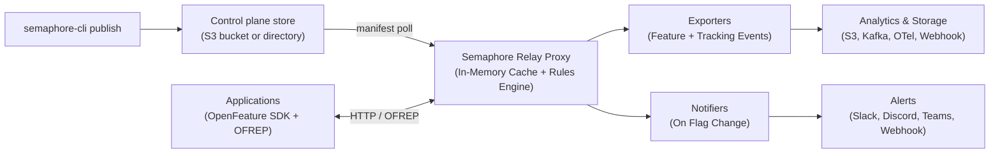

# Architecture

## Overview

Semaphore has two ways to run:

- **Relay proxy**: a stateless HTTP server used by applications via [OpenFeature SDKs](https://openfeature.dev) and [OFREP](../openfeature/ofrep.md).
- **Go module**: embed the evaluation engine directly inside a Go service with no separate proxy process.

Both share the exact same evaluation engine.

## Components

### OpenFeature SDKs and OFREP

Applications use standard [OpenFeature](https://openfeature.dev) SDKs with an [OFREP](../openfeature/ofrep.md) (OpenFeature Remote Evaluation Protocol) provider talking to the relay proxy over HTTP. Semaphore does not ship language-specific providers.

### Relay Proxy

- Single stateless Go binary with no database dependency.
- Polls a manifest in a control plane store (an S3 bucket or a directory), loads the flag sets it lists into memory, and swaps them in place when a new generation appears.
- See the [Relay Proxy docs](../relay-proxy/README.md) to get started.

### Core pipelines

- **[Control plane](control-plane-polling.md)**: the store the relay polls for flag sets. In the Go module, [retrievers](retriever.md) fetch flag definitions from files, object storage, Git, Kubernetes, or databases.
- **[Notifiers](notifier.md)**: alert external systems (Slack, Discord, Microsoft Teams, webhooks) when flag definitions change.
- **[Exporters](exporter.md)**: send flag evaluation and tracking events to analytics or monitoring sinks.

## Stack

- Written in Go.
- Notifiers and exporters use official client libraries for each backend.
