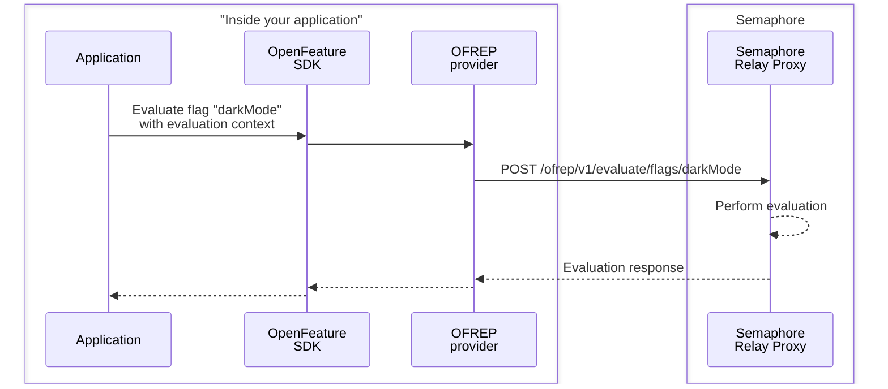

# Flag Evaluation

## Overview

**Flag evaluation** determines which variation of a feature flag to serve at runtime for a given [evaluation context](evaluation-context.md), letting you change application behavior without redeploying.

## Evaluation steps

1. **Retrieve flag configuration:** Load the flag's variations, targeting rules, and default rule.
2. **Receive evaluation context:** Read attributes for the current request or user (such as `targetingKey`, device type, location, or custom properties).
3. **Evaluate rules:** Match the context against `targeting` rules in order (user targeting, attribute rules, or percentage/progressive rollouts), falling back to `defaultRule`.
4. **Return the variation value:** Return the resolved typed value (for example, `true`, `false`, or `"variantA"`).

## Supported flag types

Semaphore supports five flag value types, with typed methods in OpenFeature SDKs and the Go module:

- **Boolean**
- **String**
- **Integer**
- **Double** (float)
- **Object** (JSON object or array)

## Example

Suppose you configure a flag named `new_checkout_flow`:

```yaml
new_checkout_flow:
  variations:
    enabled: true
    disabled: false
  targeting:
    - query: user_segment eq "early_adopters"
      variation: enabled
  defaultRule:
    percentage:
      enabled: 20
      disabled: 80
```

- Users with `user_segment` equal to `"early_adopters"` always receive `true`.
- All other users have a **20% chance** of receiving `true` and an **80% chance** of receiving `false`.

## Evaluating a flag in code

Using an OpenFeature SDK with an OFREP provider (JavaScript example):

```javascript
const evaluationContext = {
  targetingKey: "<my-key>",
  user_segment: "early_adopters",
};
const defaultValue = false;

const boolValue = await client.getBooleanValue(
  "new_checkout_flow",
  defaultValue,
  evaluationContext
);
```

In most languages, the evaluation call takes three arguments:

1. **Flag key:** The flag to evaluate (`"new_checkout_flow"`).
2. **Default value:** Returned if the flag is missing, disabled, or evaluation fails.
3. **Evaluation context:** Attributes for the current user or request (see [Evaluation Context](evaluation-context.md)).

## Benefits

- **Instant control:** Toggle features without redeploying code.
- **A/B testing:** Compare feature variations with controlled traffic splits.
- **Gradual rollouts:** Release features to a small subset of users before full rollout.
- **Kill switches:** Disable broken features immediately in production.

## How evaluation works

With OFREP, evaluation runs in the relay proxy while the OpenFeature SDK uses a generic OFREP provider over HTTP:

- **Server-side SDKs:** Call `POST /ofrep/v1/evaluate/flags/{key}` on every evaluation.
- **Client-side SDKs** (JavaScript/React, Android, Swift, ...): Fetch all flags for a single context via `POST /ofrep/v1/evaluate/flags`, cache the result locally, and refresh on context changes or on an interval.

The response includes the `semaphore_cacheable` metadata key indicating whether the result can be cached, alongside the legacy `gofeatureflag_cacheable` key for GO Feature Flag providers (see `evaluation.disableSemaphoreMetadata` in the [bootstrap file](../relay-proxy/bootstrap-config.md)).



To evaluate flags in-process without a relay proxy, see the [Go module docs](../go-module/getting-started.md).
