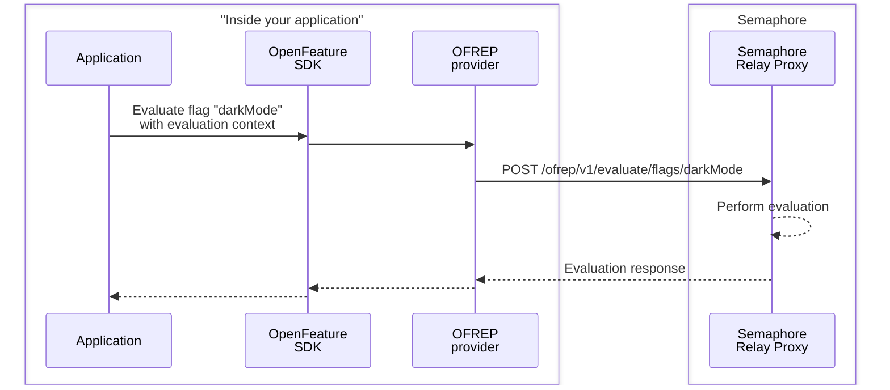

# Flag Evaluation

## Overview
In a feature flag system, flag evaluation is the process of determining the current state _(which variant to use)_ of a feature flag for a given [evaluation context](evaluation-context.md).

This process happens at runtime, allowing you to dynamically control the behavior of your application without redeploying code.

## What Happens During Evaluation?

The evaluation process typically involves these steps:

1. **Retrieving the Flag Configuration:** The system fetches the configuration for the specific flag being evaluated. This configuration includes information such as the flag's default value, targeting rules, and any other relevant settings.
2. **Contextual Input:** The evaluation receives context about the current request or user. This context can include information like:
   - A targeting key
   - Device type
   - Location
   - Custom attributes
3. **Rule Evaluation:** The system evaluates the targeting rules defined for the flag against the provided context. These rules determine which users or requests should see the feature enabled (or a specific variant). Common targeting strategies include:
   - **Percentage rollout:** Enable the feature for a percentage of users _(e.g., 50%)_.
   -  **User targeting:** Enable the feature for specific users.
   - **Attribute-based targeting:** Enable the feature based on user attributes _(e.g., users with a "premium" subscription)_.
4. **Returning the Flag Value:** Based on the rule evaluation, the system returns the appropriate value for the flag (e.g., `true`, `false`, or a variant value like `"variantA"`).

## Supported type of flags
Semaphore supports a variety of flag types, including:
- **Boolean**
- **String**
- **Integer**
- **Double**
- **Object**

For each flag type, the SDKs are providing specific APIs to be able to retrieve your flag in the right type inside your code.

## Example

Let's say you have a feature flag called `new_checkout_flow` with the following configuration:

```yaml
new_checkout_flow:
  variations:
    enabled: true
    disabled: false
  targeting:
    - query: user_segment eq "early_adopters"
      variation: enabled
  defaultRule:
    percentage:
      enabled: 20
      disabled: 80
```

If a user belongs to the `early_adopters` segment, the flag evaluation will return `true`.  
If a user does not belong to that segment, there's a **20% chance** the flag will return `true` due to the percentage rollout rule. Otherwise, the flag will return the `false`.

## Basic evaluation with Semaphore

After setting up your flag configuration, you can evaluate the flag in your application code.
For this example *(in JS)*, we'll use the OpenFeature SDK with an OFREP provider:

```javascript
const evaluationContext = {
  targetingKey: "<my-key>",
   "user_segment": "early_adopters",
};
const defaultValue = false;

// get a boolean value
const boolValue = await client.getBooleanValue(
  'new_checkout_flow',
  defaultValue,
  evaluationContext);
```

As you can see, the evaluation context API takes 3 parameters _(this is true in most languages)_:
- The name of the flag to evaluate.
- A default value to return if the flag is not found or the evaluation fails. The evaluation API will always return a value, even if there is an error.
- An evaluation context giving information about the current user or request _([more information about evaluation context](evaluation-context.md))_.

You can also see that we are explicitly asking for a boolean value because `new_checkout_flow` is a boolean flag.

## Benefits of Dynamic Evaluation

Dynamic flag evaluation provides several advantages:
- **Instant control:** Change the state of features without deploying new code.
- **A/B testing:** Run experiments and gather data on different feature variations.
- **Gradual rollouts:** Release features to a small group of users before wider deployment.
- **Kill switches:** Quickly disable problematic features in production.

## How is the evaluation performed?

With OFREP, the evaluation always happens in the relay proxy: the OpenFeature SDK uses a generic OFREP provider that
calls the relay proxy over HTTP.

- **Server-side SDKs** call the single-flag endpoint (`POST /ofrep/v1/evaluate/flags/{key}`) on every evaluation.
- **Client-side SDKs** (JavaScript/React, Android, Swift, ...) have a single evaluation context, so the OFREP provider asks for
  the evaluation of all flags at once (`POST /ofrep/v1/evaluate/flags`), keeps the result in a local cache, and refreshes it
  when the context changes or on an interval.

The `gofeatureflag_cacheable` metadata key in the response tells the client whether the result can be cached.



Evaluating flags inside the application process (as in the Go module) is described in the [Go module docs](../go-module/getting-started.md).
