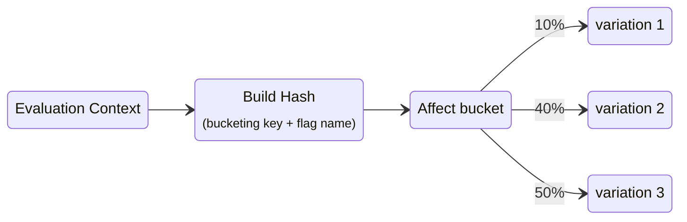

# Custom Bucketing

## Overview

By default, Semaphore hashes `targetingKey` (usually a user ID) to keep each user in the same variation bucket.

Set `bucketingKey` to hash a different context attribute instead—such as `teamId`, `companyId`, or `orgId`—so everyone sharing that attribute receives the same variation when they reach the same percentage rule (users matching different `targeting` rules can still receive different variations).

## How it works

When evaluating a flag, Semaphore hashes `targetingKey` plus the flag name to assign the user to a variation bucket. If `bucketingKey` is set on the flag, Semaphore hashes that attribute instead of `targetingKey`.



Because multiple users share the same attribute value, they all land in the same variation bucket.

> [!WARNING]
> - If the `bucketingKey` attribute is missing from the **evaluation context**, flag rules are not evaluated and the SDK returns the default value.
> - Because `bucketingKey` is shared across users, traffic splits can be uneven if attribute values vary widely in group size.
> - The `bucketingKey` value must be a **string**.

## Example: Split users by team ID

To ensure every member of the same team receives the same variation, set `bucketingKey: "teamId"`:

```yaml
scream-level-feature:
  bucketingKey: "teamId"
  variations:
    low: "whisper"
    medium: "talk"
    high: "scream"
  defaultRule:
    percentage:
      medium: 50
      high: 50
```

Include `teamId` in the evaluation context:

```go
evalCtx := openfeature.NewEvaluationContext(
    "user-123",
    map[string]any{
        "teamId": "f74b72",
    },
)
screamLevel, _ := client.StringValue(context.Background(), "scream-level-feature", "whisper", evalCtx)
```

All users with the same `teamId` receive the same variation. You can configure a different `bucketingKey` per flag.

## Example: Nested properties

Semaphore supports dot notation for accessing nested attributes in the evaluation context, such as `company.id`:

```yaml
premium-feature:
  bucketingKey: "company.id"
  variations:
    enabled: true
    disabled: false
  defaultRule:
    percentage:
      enabled: 20
      disabled: 80
```

Pass the nested structure in the evaluation context:

```go
evalCtx := openfeature.NewEvaluationContext(
    "user-456",
    map[string]any{
        "company": map[string]any{
            "id":   "company-789",
            "name": "Semaphore",
            "tier": "enterprise",
        },
    },
)
boolValue, _ := client.BooleanValue(context.Background(), "premium-feature", false, evalCtx)
```

All users sharing `company.id` receive the same variation.

> [!TIP]
> **Deep nesting**
> You can reference multiple levels of nesting, such as `user.profile.role` or `organization.settings.region`.
