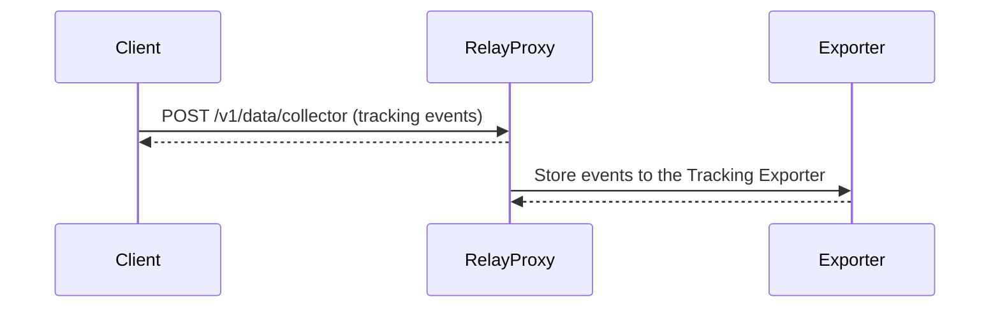

# Tracking API

## What it is

The **OpenFeature Tracking API** records custom actions or outcomes in your application (for example, visiting a promo page or completing checkout) and ties them to the same evaluation context used for flags. It follows the [OpenFeature Tracking specification](https://openfeature.dev/specification/sections/tracking/).

In an application, this looks like `client.track("event-name", context, details)`.

- **Measure flag impact**: Join [flag usage events](flag-usage-tracking.md) with tracking events to compare conversion, revenue, or other metrics per variation.
- **Experimentation**: Provides the outcome half of A/B tests alongside flag exposure data.

## Concepts

- **Event name**: String identifying the action (for example, `"clicked-checkout"`, `"visited-promo-page"`).
- **Context**: The same evaluation context (targeting key and attributes) used for flag evaluation, allowing joins with exposures.
- **Details**: Optional payload such as a numeric `value` (for example, order total) and custom fields (for example, currency or item IDs).

## How it works

The relay proxy accepts tracking events on `POST /v1/data/collector` (see `cmd/relayproxy/api/testdata/openapi.golden.json` for the request schema) and forwards them to your configured **tracking** exporters. The relay proxy never calls `track` itself.

> [!NOTE]
> Generic OFREP providers do not call `POST /v1/data/collector`. Sending tracking events requires a client that implements this endpoint (this repository does not ship one) or a direct HTTP request from your application.



## Setup

1. **Send tracking events** from your application to `POST /v1/data/collector` on the relay proxy.
2. **Configure a tracking exporter**: Add an exporter entry with `eventType: "tracking"`. See [export evaluation data](../integrations/exporters/README.md).

To send both flag-usage and tracking events to the same backend, define two exporter entries: one for `feature` events and one with `eventType: "tracking"`.

## Event format

Each tracking event sent to your exporters has the following fields:

| Field | Description |
|---|---|
| `kind` | Always `"tracking"` for custom tracking events. |
| `contextKind` | `"user"` for a known user, or `"anonymousUser"` for an anonymous context. |
| `userKey` | Targeting key (user or entity identifier) from the evaluation context. |
| `creationDate` | Unix timestamp (seconds) when the event was recorded. |
| `key` | Tracking event name (for example, `"clicked-checkout"`). |
| `evaluationContext` | Evaluation context (targeting key and attributes) used to join with flag exposures. |
| `trackingEventDetails` | Optional numeric `value` and custom key-value fields (booleans, strings, numbers, or nested structures per the [OpenFeature Tracking specification](https://openfeature.dev/specification/sections/tracking/)). |

### Example

```json
{
  "kind": "tracking",
  "contextKind": "user",
  "userKey": "94a25909-20d8-40cc-8500-fee99b569345",
  "creationDate": 1618909178,
  "key": "clicked-checkout",
  "evaluationContext": {
    "targetingKey": "94a25909-20d8-40cc-8500-fee99b569345",
    "email": "user@example.com"
  },
  "trackingEventDetails": {
    "value": 99.77,
    "currencyCode": "USD"
  }
}
```

For exact field types and semantics, see the [OpenFeature Tracking specification](https://openfeature.dev/specification/sections/tracking/).
